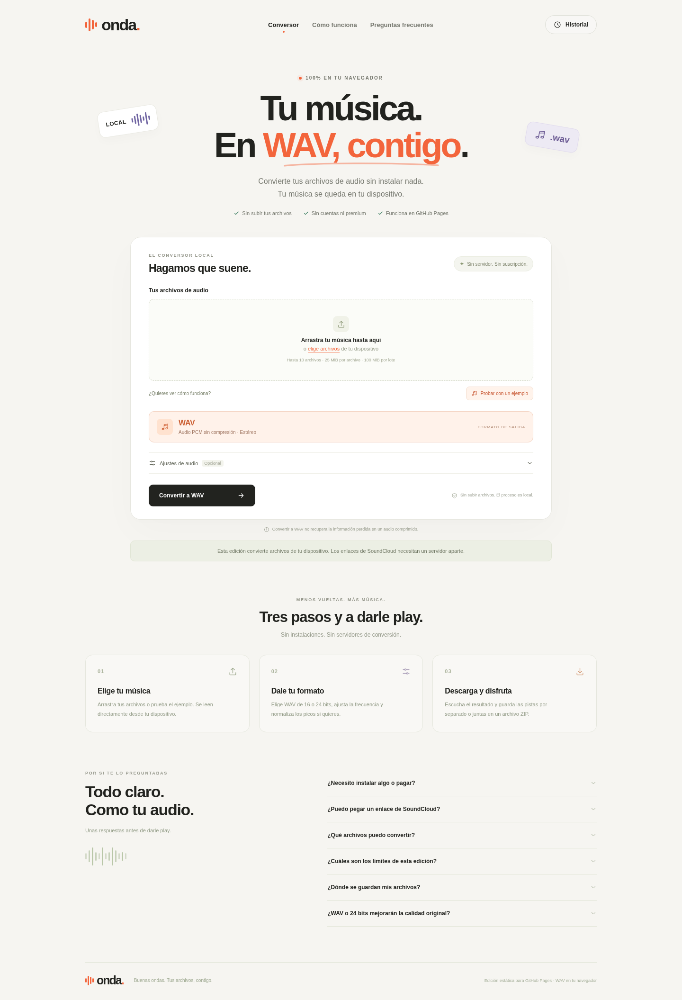

# Onda · edición para GitHub Pages

Conversor a WAV que funciona en el navegador. No necesita Python, un servidor de
conversión, cuentas, pagos ni instalar programas en el dispositivo del usuario.
Los archivos de audio no se suben: se decodifican, procesan y guardan localmente.
No utiliza servicios de conversión, CDNs, FFmpeg/WASM ni claves de API.

## Probar sin instalar nada

1. Descarga [Onda en un solo archivo HTML](../web/onda-sin-instalar-v1.html?raw=true).
2. Ábrelo con un navegador moderno, como Chrome o Edge.
3. Pulsa **Probar con un ejemplo**, después **Convertir a WAV** y descarga el
   resultado. También puedes elegir tus propios archivos de audio.

El HTML incluye el diseño y todo el código necesario. No requiere abrir una
terminal ni instalar un servidor local.

## Publicar solo con GitHub

La rama `gh-pages` contiene únicamente los archivos de esta web, preparados para
publicarse. En el repositorio:

1. Abre **Settings → Pages**.
2. En **Build and deployment**, selecciona **Deploy from a branch**.
3. Elige **gh-pages** y **/(root)**, y pulsa **Save**.

GitHub mostrará el enlace cuando termine su publicación. GitHub Pages está
disponible sin un plan de pago en repositorios públicos; este repositorio se
comprobó como público al preparar esta versión. No se necesita GitHub Actions,
un dominio propio ni un servicio externo.

Los recursos usan rutas relativas, de modo que funcionan tanto en la raíz como
en una página de proyecto. `.nojekyll` evita que Jekyll transforme los archivos.
La creación de una rama no acredita que Pages esté habilitado ni que el sitio ya
esté desplegado; esa comprobación se documenta por separado.

## Qué hace esta edición

- Admite archivos que el navegador pueda decodificar: habitualmente MP3, WAV,
  M4A/AAC, FLAC y OGG, con diferencias según navegador y dispositivo.
- Genera WAV PCM de **16 o 24 bits**, a **44,1 o 48 kHz**, en estéreo.
- Ofrece normalización opcional de los picos a −1 dBFS.
- Convierte varios archivos, muestra su progreso y permite descargar WAV
  individuales o un ZIP.
- Incluye un ejemplo de audio sintético generado en el propio navegador.
- El historial se conserva en ese navegador cuando su almacenamiento local
  está disponible y los archivos caben en su límite. Puede borrarse desde la web.

Convertir a WAV no recupera los detalles perdidos en el archivo de origen.
Esta edición **no descarga enlaces de SoundCloud**. Para eso se necesita la
[versión con servidor](../soundcloud-converter/README.md), conservada aparte.
No se muestran botones que simulen una descarga de SoundCloud.

## Límites técnicos

El procesamiento usa la memoria del dispositivo. Se limita cada archivo a
25 MiB y diez minutos, el lote a diez archivos y 100 MiB de entrada, y la salida
conjunta a 200 MiB. No son límites de una suscripción. Para archivos grandes o
más formatos de salida puede usarse la edición con servidor.

## Código y pruebas

`index.html` y `assets/` son los archivos del sitio. No hay una compilación ni
dependencias que instalar para publicarlo. Las pruebas de desarrollo usan
Chromium y audio sintético; no envían archivos a servicios externos.

La versión descargable de un solo HTML se genera a partir de esos mismos
recursos. Se comprobó por HTTP y después sin conexión, sin cargar recursos
adicionales. La política del navegador administrado del entorno bloqueó la
apertura de direcciones `file://`; no se presenta esa apertura local como
verificada en este entorno. Esto no afecta al uso normal por GitHub Pages.

Consulta los [resultados de validación](docs/VALIDACION.md).
