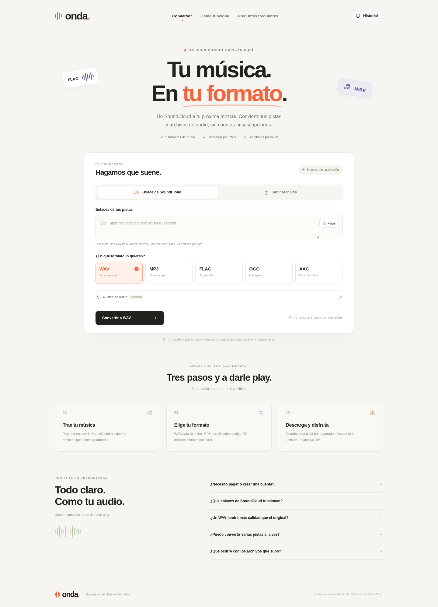

# Onda · Conversor de audio

Web propia en español para convertir audio, con enlaces públicos de SoundCloud,
archivos subidos, selección de formato, cola de trabajos y descargas individuales
o en ZIP. No incorpora suscripciones, cuentas, créditos ni funciones premium.

El código y el diseño son independientes de Songverter. La página de referencia
no pudo inspeccionarse en el entorno inicial porque su dominio estaba bloqueado
por la política de red; no se presenta como una copia visual exacta.



[Descargar el proyecto completo](../web/onda-v1.zip?raw=true) ·
[Resultados de validación](docs/VALIDACION.md)

## Ejecutar

Necesitas Python 3.12 o posterior y FFmpeg/FFprobe en el `PATH`.

```sh
cd soundcloud-converter
python3 -m venv .venv
.venv/bin/python -m pip install -r requirements.txt
.venv/bin/python -m uvicorn app:app --host 0.0.0.0 --port 8000 --workers 1
```

En Windows, los ejecutables del entorno están en `.venv\Scripts\`.
La página se sirve en el puerto 8000, con el backend y los recursos de la web en
el mismo servidor. No hay una compilación de JavaScript ni claves de API que
configurar. En Debian/Ubuntu puedes instalar FFmpeg con `apt install ffmpeg`.

Es importante mantener **un proceso de Uvicorn**: la cola de trabajos vive en ese
proceso. Las conversiones usan un grupo de hilos independiente.

## Con Docker

```sh
cd soundcloud-converter
docker compose up --build -d
docker compose logs -f
```

El contenedor ejecuta la aplicación como usuario sin privilegios y guarda el
audio en el volumen `converted-audio`. GitHub Pages solo sirve archivos
estáticos, por lo que no puede ejecutar por sí solo este conversor. Para una URL
pública necesitas un alojamiento que ejecute Python/FFmpeg o contenedores.

## Funciones

- Pegar varios enlaces públicos de SoundCloud y listas de reproducción.
- Subir varios archivos de audio mediante selector o arrastrándolos a la página.
- Convertir a WAV PCM de 16 o 24 bits, MP3, FLAC, OGG Vorbis o AAC en M4A.
- Elegir 44,1 o 48 kHz y activar normalización de volumen.
- Consultar el estado real de la conversión y sus resultados por pista.
- Descargar cada archivo o reunir los resultados correctos en un ZIP.
- Recuperar trabajos recientes desde el historial de ese navegador mientras
  sigan disponibles en el servidor.

La conversión a WAV o FLAC no recupera información que ya se perdió en un audio
comprimido. SoundCloud puede ofrecer una calidad diferente de la grabación
original. No se eluden contenido privado, acceso de pago ni protecciones DRM;
usa archivos propios o pistas para las que tengas permiso.

Los archivos se procesan en el servidor, no exclusivamente en el navegador.
No se envían a Songverter ni a un servicio de conversión de pago.

## Red y SoundCloud

El servidor debe poder acceder por HTTPS a `soundcloud.com`, sus subdominios y
los servidores de audio `*.sndcdn.com`. Las descargas pueden depender de la
disponibilidad de SoundCloud, restricciones de la pista y cambios de su servicio.
Un bloqueo de red se muestra como error; no se inventa una conversión correcta.

En Codex Cloud se guardó una propuesta de acceso para:

```text
songverter.com
www.songverter.com
soundcloud.com
*.soundcloud.com
*.sndcdn.com
```

Los dominios de Songverter solo sirven para inspeccionar la referencia. Onda no
los necesita en producción. Guardar ese borrador no aplica automáticamente la
política al entorno en ejecución: revisa y guarda los cambios en la
configuración del entorno y, cuando corresponda, publica el entorno.

Se conservan la verificación TLS y las variables de proxy proporcionadas por el
entorno. No añadas opciones para desactivar la verificación de certificados.

## Configuración opcional

| Variable | Valor predeterminado | Uso |
| --- | --- | --- |
| `ONDA_DATA_DIR` | `.data` | Carpeta de trabajo del servidor |
| `ONDA_MAX_UPLOAD_MB` | `200` | Tamaño máximo por archivo |
| `ONDA_MAX_PLAYLIST_TRACKS` | `50` | Máximo de pistas por lista |
| `ONDA_JOB_TTL_HOURS` | `24` | Caducidad de los resultados |
| `ONDA_MAX_WORKERS` | `2` | Conversiones simultáneas |

Son límites técnicos configurables, no restricciones premium. Si alojas la web
para terceros, configura en tu proxy HTTPS límites de peticiones y tamaño de
carga acordes con los recursos del servidor. La aplicación no incluye un sistema
de registro de usuarios.

También hay un máximo de 20 enlaces por solicitud, 400 MB por lote de archivos
con la configuración predeterminada y tres horas de duración por audio.
Las playlists comparten el máximo de pistas del trabajo.

## Comprobaciones

```sh
.venv/bin/python -m pip install -r requirements-dev.txt
.venv/bin/python -m pytest -q
```

Las pruebas de backend generan audio de muestra y ejecutan conversiones reales
con FFmpeg, sin depender de SoundCloud. Para la prueba de navegador, con el
servidor iniciado:

```sh
.venv/bin/python -m playwright install chromium
.venv/bin/python tests/browser_smoke.py --base-url http://127.0.0.1:8000
```

También puedes usar un Chromium ya instalado indicando su ruta mediante
`CHROMIUM_EXECUTABLE`. Los resultados de navegador se guardan en `artifacts/`,
una carpeta ignorada por Git.

La respuesta de `/api/health` distingue la instalación del extractor de
SoundCloud de una comprobación efectiva de conectividad. La disponibilidad del
proveedor no demuestra que un enlace real pueda descargarse.
