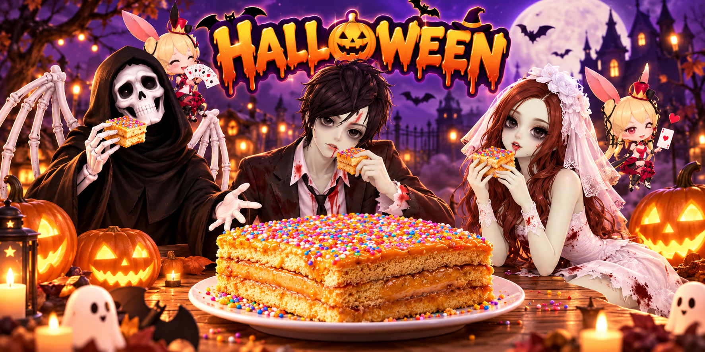
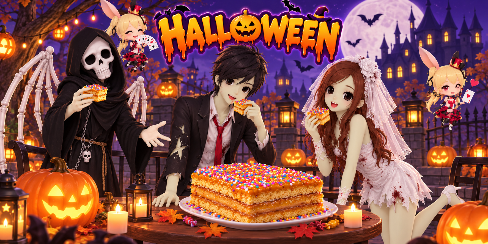
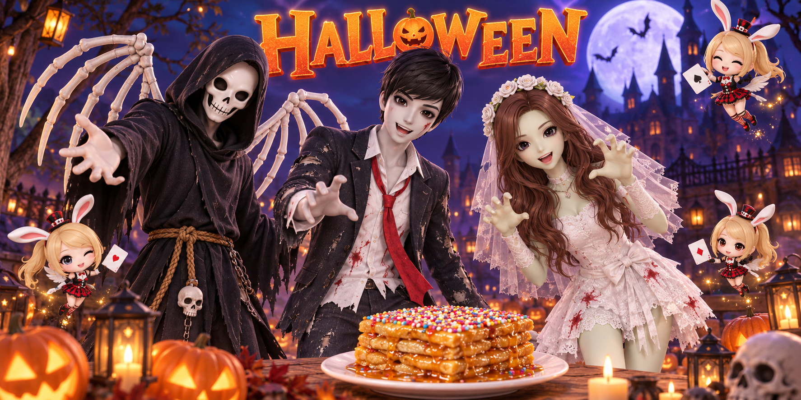
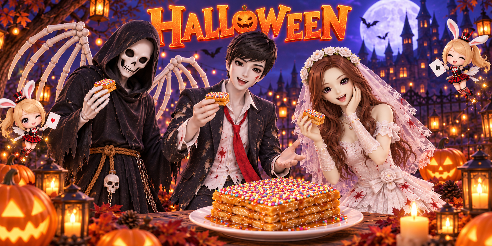
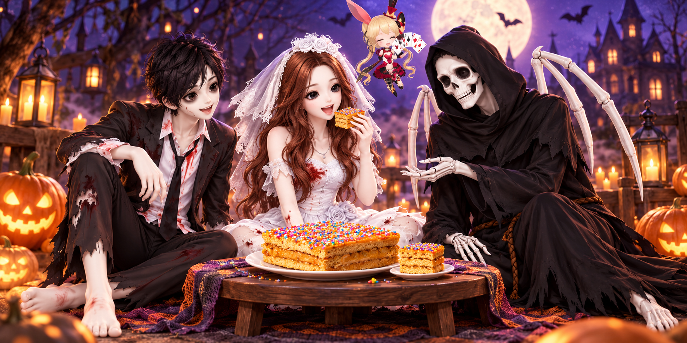
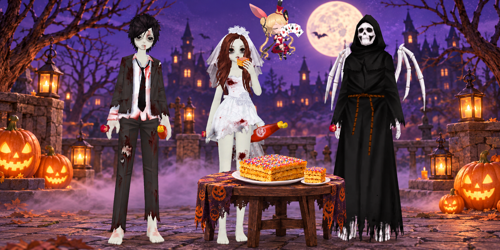

# Versiones del banner de Halloween

Cada propuesta se conserva en archivos separados y numerados. Las versiones anteriores no se reemplazan. Ninguna versión está marcada como definitiva o aprobada.

## Versión 1: primera versión

[Ver PNG](banner-halloween-v1.png) · [Descargar ZIP](banner-halloween-v1.zip)

## Versión 2: segunda versión

[Ver PNG](banner-halloween-v2.png) · [Descargar ZIP](banner-halloween-v2.zip)

## Versión 3: tercera versión

[Ver PNG](banner-halloween-v3.png) · [Descargar ZIP](banner-halloween-v3.zip)

## Versión 4: cuarta prueba

Nueva propuesta independiente. La fidelidad al estilo de los renders de referencia sigue pendiente.

[Ver PNG](banner-halloween-v4.png) · [Descargar ZIP](banner-halloween-v4.zip)

## Versión 5: nueva propuesta

Los tres personajes en un fondo de Halloween, con la novia a punto de comer turrón de Doña Pepa.

[Ver PNG](banner-halloween-v5.png) · [Descargar ZIP](banner-halloween-v5.zip)

## Versión 6: corrección de estilo

Nueva propuesta basada en los renders originales de LoveRitmo: personajes de pie, aspecto zombi y la novia intentando comer el turrón de Doña Pepa.

[Ver PNG](banner-halloween-v6.png) · [Descargar ZIP](banner-halloween-v6.zip)
